# Medicare Part D Drug Spend Warehouse


  

**Business problem.** Medicare Part D spending is driven by a small set of molecules, prescribers
and specialties, and much of it goes to brand-name drugs that have cheaper generic equivalents.
Pharmacy-benefit and policy analysts need a trustworthy warehouse that answers *what is driving spend
growth* and *how much generic substitution could save*, even when the source files are late,
restated, renamed and dirty.

**What this repo is.** A production-style batch warehouse on the CMS *Medicare Part D Prescribers by
Provider and Drug* dataset: contract-enforced ingestion, a dbt Kimball star schema with an SCD Type 2
prescriber history that survives late-arriving corrections, row-level quarantine, and an automated
reconciliation that proves every injected defect was handled.

## Measured result

Every CI run regenerates **32,728 rows** across 4 files with **1,971 injected defects in 9 classes**
(plus a 10,917-row legacy-schema file), runs the pipeline, and reconciles the outcome against the
generator's answer key. The build fails if a single row is mishandled.

| Defect class | How it is handled | Injected | Caught |
|---|---|---:|---:|
| Exact duplicate rows | removed in staging (row hash within batch) | 319 | 319 |
| Restated rows in a late 2022 correction | older version marked `superseded` | 404 | 404 |
| New 2022 rows that arrived a year late | accepted from the v2 file | 53 | 53 |
| Invalid NPI | quarantined: `invalid_npi` | 63 | 63 |
| Negative measures | quarantined: `negative_measure` | 30 | 30 |
| Missing drug cost | quarantined: `missing_drug_cost` | 94 | 94 |
| Prescriber-years with no specialty | explicit `UNKNOWN` member | 40 | 40 |
| Wrong 2022 specialty, fixed by the late file | SCD2 rebuilt: 1 version per corrected NPI | 10 | 10 |
| Casing / whitespace noise | normalized (24 distinct drugs = catalog) | 958 | 958 |
| Legacy column names + `$1,234.56` costs | mapped by contract aliases, parsed | 10,917 rows | 10,917 |

Accepted rows reconcile to the fact table **to the cent** (`assert_fact_reconciles_to_accepted_rows`).
The suite was mutation-checked: deliberately breaking restatement ordering, SCD2 change detection,
case normalization, or the NPI rule makes the tests fail every time. `make run` also writes per-stage
runtimes for your machine to `data/reports/defect_report.md`.

## Architecture

```mermaid
flowchart LR
    SRC["CMS Part D files<br/>(synthetic or real)"] --> LAND["Landing, immutable<br/>arrival_date=YYYY-MM-DD/<br/>partd_YEAR_vN.csv"]
    LAND --> CONTRACT{{"Data contract<br/>aliases, required,<br/>ignored, unknown = fail"}}
    CONTRACT --> RAW[("raw.part_d_prescriber_drug<br/>all text + lineage<br/>raw._load_audit")]
    RAW --> STG["stg_part_d__prescriber_drug<br/>typed, cleaned, one row_status per row"]
    STG -- "quarantined / duplicate / superseded" --> DQ["dq_quarantine<br/>dq_reconciliation"]
    STG -- accepted --> INT["int_part_d__accepted<br/>int_prescriber_yearly_attributes"]
    INT --> DIMS["dim_prescriber (SCD2)<br/>dim_drug, dim_geography"]
    INT --> FCT["fct_prescriptions<br/>grain: NPI x drug x year"]
    DIMS --> FCT
    FCT --> MARTS["mart_drug_spend_trend<br/>mart_generic_savings_opportunity<br/>mart_specialty_spend"]
    DQ --> REPORT[["defect report + dbt docs"]]
    MARTS --> REPORT
```



| Layer | Where | What happens |
|---|---|---|
| Landing | `data/landing/` | Files exactly as delivered, partitioned by arrival date. Never modified. |
| Contract + bronze | `contracts/`, `src/drugspend/ingest.py` | Header mapped to canonical names; unknown or missing columns reject the file; SHA-256 fingerprint makes loads idempotent. |
| Raw | `raw` schema | Every value as text plus lineage (`_batch_id`, `_source_file`, `_arrival_date`, `_file_version`, `_row_hash`, ...). |
| Staging (silver) | `dbt/models/staging` | Types, cleaning, dedupe, restatement resolution, quality rules. Nothing dropped: each row is labelled. |
| Marts (gold) | `dbt/models/marts` | Kimball star schema with point-in-time joins, plus three analytics marts. |
| Quality | `dbt/models/quality` | Quarantine table and row-level reconciliation. |

Why each choice was made: [docs/decisions/](docs/decisions/README.md).

## Quickstart

Requires Docker (Desktop or Engine with Compose v2). About 2 minutes on first build.

```bash
git clone https://github.com/priyank1510/medicare-drug-spend-warehouse.git
cd medicare-drug-spend-warehouse
make up      # build image, start dbt docs server on http://localhost:8080
make run     # generate -> ingest -> dbt build (models + tests) -> defect report
make test    # pytest: unit + end-to-end
make sql Q="select * from marts.mart_generic_savings_opportunity order by potential_gross_savings desc limit 5"
make down    # stop containers
make clean   # remove containers, images, volumes and all generated files (back to a fresh clone)
```

No Docker? `make local-setup && make local-run && make local-test` (Python 3.10+).

Real data: `make download-cms STATE=WI YEAR=2023`, then `make shell` and run
`python -m drugspend.cli ingest && python -m drugspend.cli transform`. The same contract and models
process it unchanged. The defect report only applies to synthetic runs, because real data has no answer key.

## What it answers

```sql
-- Which molecules drive spend growth?
select generic_name, data_year, total_drug_cost, yoy_cost_change_pct, spend_rank_in_year
from marts.mart_drug_spend_trend where data_year = 2023 order by spend_rank_in_year limit 5;

-- Upper-bound savings if brand days of supply were dispensed at the generic cost per day
select generic_name, data_year, brand_share_of_days_pct, potential_gross_savings
from marts.mart_generic_savings_opportunity order by potential_gross_savings desc;

-- Spend by specialty, using the specialty that was true in that year (SCD2)
select * from marts.mart_specialty_spend where data_year = 2023 order by total_drug_cost desc;
```

CMS cost is gross, before manufacturer rebates, so savings figures are an upper bound. Synthetic
costs are illustrative and are not real Medicare figures.

## Testing

| Layer | What | Count |
|---|---|---|
| dbt data tests | unique / not_null / accepted_values / relationships / custom `non_negative` and `unique_combination` | 46 |
| dbt singular tests | raw = staged rows, fact = accepted rows to the cent, SCD2 no overlap, one current version, no unknown-member hits, attribute consistency (warn) | 6 |
| dbt unit tests | row-status precedence; SCD2 versioning (stable, move, gap year, A -> B -> A) | 2 |
| pytest | contract drift cases, generator determinism and CMS rules, ingestion idempotency and immutability, end-to-end reconciliation, rerun idempotency, late-correction history | 24 |
| Reconciliation | expected vs actual for every defect class | 11 checks |

CI (GitHub Actions) runs the full pipeline, pytest, and a Docker build on every push, and posts the
defect report to the job summary.

## Repository layout

```
contracts/                 data contract (YAML)
src/drugspend/             generate, contract, ingest, report, cli, download_cms
dbt/models/staging         typed + labelled rows
dbt/models/intermediate    accepted rows, yearly prescriber attributes
dbt/models/marts/core      dim_prescriber (SCD2), dim_drug, dim_geography, fct_prescriptions
dbt/models/marts/analytics spend trend, generic savings, specialty spend
dbt/models/quality         quarantine, reconciliation
dbt/tests                  singular + generic tests
tests/                     pytest
docs/decisions/            ADRs
```

## Limitations and next steps

- Single-node by design. At national scale (25M+ rows per year), partition the fact by `data_year`
  and rebuild only affected years.
- Orchestration is `make` + the CLI. An Airflow or Dagster DAG with retries and alerting is the
  natural next step.
- Add a quarantine-rate alert threshold, and join NPPES for richer prescriber attributes.

Data source: [CMS Medicare Part D Prescribers by Provider and Drug](https://data.cms.gov/provider-summary-by-type-of-service/medicare-part-d-prescribers/medicare-part-d-prescribers-by-provider-and-drug).
